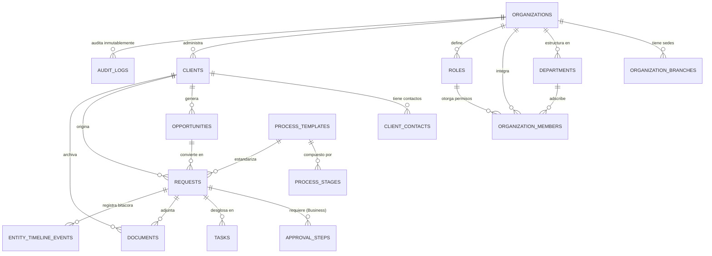

# COREFLOW — ARQUITECTURA DE PLATAFORMA Y NÚCLEO ORGANIZACIONAL

**Versión:** 1.0 (Diseño Técnico Integral Pre-Implementación)  
**Autor:** Webcore Solutions  
**Estado:** Pendiente de aprobación para iniciar implementación por etapas  

---

## 1. Diagnóstico del Repositorio Actual (Cierre de Fase 1)

### 1.1 Estructura actual inspeccionada
```text
COREFLOW/
├── public/brand/                              # Activos SVG oficiales de identidad
├── src/
│   ├── components/
│   │   ├── brand/CoreFlowLogo.jsx             # Geometría dinámica e isotipo
│   │   ├── charts/ProcessEvolutionChart.jsx   # Gráfico SVG interactivo
│   │   ├── layout/AppShell.jsx                # Sidebar, Topbar y navegación móvil
│   │   ├── modals/QuickActionModals.jsx       # Modales y RequestDetailDrawer
│   │   └── ui/Primitives.jsx                  # Design System (Button, KpiCard, StatusBadge...)
│   ├── data/demoStore.js                      # Estado demostrativo en memoria y reglas básicas
│   ├── styles/tokens.css                      # Variables CSS centralizadas (--cf-*)
│   ├── views/
│   │   ├── AuthView.jsx                       # Pantallas 1 y 2 (Login y Recuperación)
│   │   ├── DashboardView.jsx                  # Pantalla 3 (Dashboard Operativo / Ejecutivo)
│   │   ├── DesignSystemView.jsx               # Documentación viva del UI Kit
│   │   └── ModulesPreviewView.jsx             # Vistas preliminares de módulos
│   ├── App.jsx                                # Orquestador actual de estado en memoria
│   └── main.jsx
```

### 1.2 Brechas arquitectónicas identificadas frente a la meta empresarial
1. **Acoplamiento Estado-Vista:** `App.jsx` y `demoStore.js` almacenan arreglos planos sin integridad referencial ni separación por `organization_id`.
2. **Ausencia de Jerarquía Organizacional Real:** El selector de entorno en `AppShell.jsx` es actualmente cosmético; no filtra datos por organización (`Tenant`), sede (`Branch`), departamento (`Department`) ni equipo (`Team`).
3. **Relaciones No Estructuradas:** Las referencias entre Solicitudes, Clientes, Tareas y Documentos son cadenas de texto descriptivas en lugar de claves foráneas (`client_id`, `opportunity_id`, `request_id`, `process_instance_id`) con propagación real de eventos.
4. **Seguridad y Auditoría Solo en Presentación:** No existe aún un registro inmutable de auditoría (`audit_logs`) ni un motor de autorización en capa de servicios que valide `Tenant + Plan + Rol + Alcance (Scope)` antes de permitir una mutación.

---

## 2. Arquitectura Multi-Tenant y Modelo Organizacional (Pilares 1 y 2)

### 2.1 Estrategia de Aislamiento Multi-Tenant
Se adopta el patrón **Shared Database, Shared Schema con Aislamiento por `organization_id` y Row Level Security (RLS)** en PostgreSQL/Supabase:
- **Columna obligatoria `organization_id uuid not null`:** Presente en todas las tablas de negocio, estructura, seguridad y auditoría.
- **Evaluación RLS optimizada (`InitPlan`):** Siguiendo las mejores prácticas validadas en Webcore (`SiZO` H10), las políticas RLS invocan `(select app_current_org_id())` para que el planificador de PostgreSQL evalúe el claim del JWT una sola vez por consulta y no fila por fila.
- **Membresía Multi-Organización:** Un usuario autenticado (`auth.users`) puede pertenecer a múltiples organizaciones mediante la tabla `organization_members`, manteniendo una organización activa por sesión.

### 2.2 Jerarquía Interna de una Organización
Para soportar desde una PYME de 5 personas (**CoreFlow Start**) hasta una organización departamentalizada de 30 colaboradores o más (**CoreFlow Business** y futura evolución), el modelo organizacional se estructura en 4 niveles:

1. **Organización (`organizations`):** Entidad raíz del tenant (razón social, identificación tributaria, edición activa `start` | `business`, límites de capacidad y huso horario).
2. **Sedes / Unidades Operativas (`organization_branches`):** Permite operar con una sede principal por defecto en *Start* o múltiples sedes/sucursales en *Business*.
3. **Departamentos / Áreas (`departments`):** Unidades funcionales (ej. *Operaciones, Comercial, Documentación, Calidad, Tecnología*). Soporta `parent_department_id` para sub-áreas y `lead_member_id` (responsable de área).
4. **Equipos y Colaboradores (`teams`, `organization_members`):** Cada colaborador es un registro en `organization_members` vinculado a un `user_id`, una sede (`branch_id`), un departamento primario (`department_id`), un rol (`role_id`) y uno o varios equipos operativos (`team_members`).

---

## 3. Identidad, Autenticación, Roles y Permisos (Pilar 3)

### 3.1 Separación entre Identidad y Membresía
- **`user_profiles`:** Datos globales de la persona (nombre completo, correo, avatar, preferencias de interfaz), sincronizados 1:1 con `auth.users` de Supabase.
- **`organization_members`:** Contexto laboral del usuario dentro de una organización específica (cargo, departamento, rol asignado, estado `active` | `invited` | `suspended`).

### 3.2 Motor de Autorización de Triple Capa (`Entitlements + RBAC + Scope`)
Ninguna acción se valida únicamente ocultando un botón en React. Toda operación pasa por el `AuthorizationEngine` en la capa de servicios y por RLS en base de datos evaluando tres preguntas en orden:

1. **Capa 1 — Capacidad del Plan (`Edition Entitlement`):**
   - ¿La edición activa de la organización (`start` vs. `business`) incluye la funcionalidad solicitada (ej. `departments.manage`, `approvals.multilevel`, `automations.cross_area`) y está dentro de la cuota (`max_collaborators`)?
2. **Capa 2 — Permiso del Rol (`RBAC`):**
   - ¿El rol del colaborador (`ORG_ADMIN`, `OPS_COORDINATOR`, `COMMERCIAL_LEAD`, `SPECIALIST`, `VIEWER`) posee el permiso atómico (`resource:action`, ej. `requests:approve_level`, `clients:write`, `documents:validate`)?
3. **Capa 3 — Alcance Organizacional (`Data Scope`):**
   - ¿Sobre qué conjunto de filas tiene efecto ese permiso?
     - `ORG_WIDE`: Todos los registros del tenant (`organization_id`).
     - `DEPARTMENT_SCOPE`: Registros cuyo `department_id` coincide con el departamento del colaborador o áreas delegadas.
     - `ASSIGNED_ONLY`: Registros donde el colaborador es `owner_member_id`, `assigned_member_id` o observador explícito.

---

## 4. Modelo Entidad-Relación y Grafo Operativo (Pilar 4)

### 4.1 Diagrama Entidad-Relación (Núcleo + Módulos)


### 4.2 Reglas de Conexión Real entre Módulos
1. **Cliente → Comercial:** Una `opportunity` siempre referencia a un `client_id`. Si el prospecto se convierte en cliente activo al ganar la oportunidad (`stage = 'won'`), el estado del cliente pasa automáticamente de `onboarding`/`prospect` a `active` y se dispara la creación de una solicitud de implementación (`request`).
2. **Solicitud → Proceso y Aprobaciones:** Toda `request` puede instanciar un `process_template_id`. En **CoreFlow Business**, las etapas críticas generan registros en `approval_steps` asignados a un departamento o rol aprobador; la solicitud no puede pasar a `completed` si existen pasos de aprobación obligatorios en estado `pending` o `rejected`.
3. **Solicitud / Oportunidad → Tareas:** Una `task` puede crearse desde la vista de Tareas o directamente dentro de una Ficha de Cliente, una Oportunidad o una Solicitud (`linked_entity_type`, `linked_entity_id`, `request_id`, `client_id`). Completar tareas actualiza el porcentaje de avance de la solicitud vinculada.
4. **Transversalidad Documental:** Todo registro en `documents` pertenece a la organización y se vincula opcionalmente a `client_id`, `request_id`, `opportunity_id` o `process_template_id`. El cambio de estado de un documento requerido (ej. de `pending` a `approved`) queda registrado en la bitácora de la solicitud y del cliente.

---

## 5. Auditoría, Trazabilidad y Borrado Lógico (Pilar 5)

1. **Tabla Inmutable `audit_logs`:**
   - Registra toda operación de creación, actualización, cambio de estado, aprobación, cambio de rol/permiso y archivado lógico.
   - Campos: `id`, `organization_id`, `actor_member_id`, `actor_role_snapshot`, `module`, `entity_type`, `entity_id`, `action`, `summary`, `changes_json` (`{ before, after }`), `created_at`.
   - En PostgreSQL se protege con política RLS `FOR UPDATE USING (false)` y `FOR DELETE USING (false)`.
2. **Bitácora de Negocio (`entity_timeline_events`):**
   - Alimenta la línea de tiempo visible en la Ficha de Cliente, el Detalle de Solicitud y la "Actividad reciente" del Dashboard. Permite tanto eventos automáticos del sistema como comentarios/observaciones manuales de los colaboradores.
3. **Soft Delete Universal (`deleted_at`, `deleted_by`):**
   - Ninguna entidad crítica se destruye con `DELETE`. Se marca `deleted_at = now()` mediante funciones controladas, preservando la trazabilidad histórica en reportes e indicadores.

---

## 6. Arquitectura de Módulos y Servicios Compartidos en Frontend (Pilar 6)

Para evitar que las vistas React contengan lógica de negocio o manipulen arreglos directamente, se introducirá la capa `src/core/` con separación estricta de responsabilidades:

```text
src/
├── core/
│   ├── config/
│   │   ├── editions.config.js          # Definición declarativa de cuotas y features Start vs Business
│   │   └── permissions.config.js       # Matriz RBAC y alcances por defecto
│   ├── context/
│   │   └── CoreFlowPlatformContext.jsx # Proveedor unificado de Tenant, Sesión, Permisos y Servicios
│   ├── domain/
│   │   ├── stateMachines.js            # Reglas de transición de estados (Solicitudes, Oportunidades, Docs)
│   │   └── validators.js               # Validaciones de integridad referencial y reglas de negocio
│   ├── providers/
│   │   ├── DataProviderInterface.js    # Contrato agnóstico de persistencia
│   │   ├── LocalRelationalProvider.js  # Base de datos relacional en cliente (con persistencia localStorage)
│   │   └── SupabaseDataProvider.js     # Adaptador listo para Supabase PostgreSQL + Auth + Storage
│   └── services/
│       ├── OrganizationService.js      # Gestión de tenants, sedes, departamentos, equipos y miembros
│       ├── AuthorizationService.js     # Evaluación can(action, resource, record) y checkEntitlement()
│       ├── AuditAndTimelineService.js  # Registro automático de auditoría y eventos de bitácora
│       ├── WorkflowEngineService.js    # Ejecución de automatizaciones y aprobaciones multinivel
│       └── MetricsEngineService.js     # Cálculo reactivo de KPIs acumulados y por período
```

---

## 7. Modelo de Capacidades Start vs. Business (Pilar 7)

| Capacidad / Límite (`Entitlement Key`) | CoreFlow Start | CoreFlow Business | Aplicación en Capa de Servicios y BD |
|---|---|---|---|
| `org.max_collaborators` | Hasta **15** | Hasta **30** | `OrganizationService.inviteMember()` rechaza altas si `count >= max`. |
| `org.multi_branch` | **1** sede principal | **Múltiples** sedes | En Start las entidades se asignan automáticamente a la sede matriz. |
| `org.departments_and_teams` | Deshabilitado (`false`) | Habilitado (`true`) | En Business habilita CRUD de departamentos/equipos y filtrado transversal. |
| `security.granular_permissions` | Roles base fijos | Roles y alcances por área | En Business aplica alcance `DEPARTMENT_SCOPE` y permisos por acción. |
| `workflow.multilevel_approvals` | Flujo simple (1 paso) | Cadena multinivel (N pasos) | `WorkflowEngineService` exige aprobación de todos los niveles antes de cerrar. |
| `workflow.cross_area_automations` | Reglas básicas de alerta | Reglas entre departamentos | Permite que un evento en Comercial genere solicitudes/tareas en Operaciones. |
| `analytics.responsible_indicators` | KPIs globales de org. | KPIs por área y responsable | Habilita agregaciones analíticas por `department_id` y `assigned_member_id`. |

---

## 8. Preparación para PostgreSQL / Supabase (Pilar 8)

Se creará el directorio `supabase/migrations/` en la raíz del proyecto con el esquema SQL de producción completo:
1. **`001_core_tenancy_and_org.sql`**: Tablas `organizations`, `organization_branches`, `departments`, `teams`, `user_profiles`, `organization_members`, `roles`, `role_permissions` y funciones helper RLS con `InitPlan`.
2. **`002_operational_modules.sql`**: Tablas `clients`, `client_contacts`, `opportunities`, `process_templates`, `process_stages`, `requests`, `approval_steps`, `tasks`, `documents` con claves foráneas e índices compuestos por `(organization_id, status, created_at desc)`.
3. **`003_audit_and_security_policies.sql`**: Tablas `audit_logs`, `entity_timeline_events`, triggers automáticos de `updated_at` y políticas RLS granulares para cada tabla.
